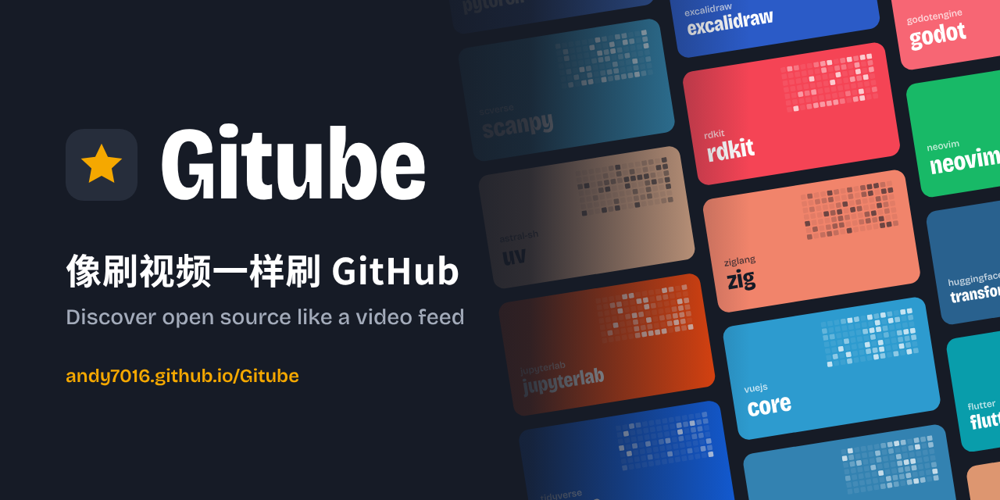
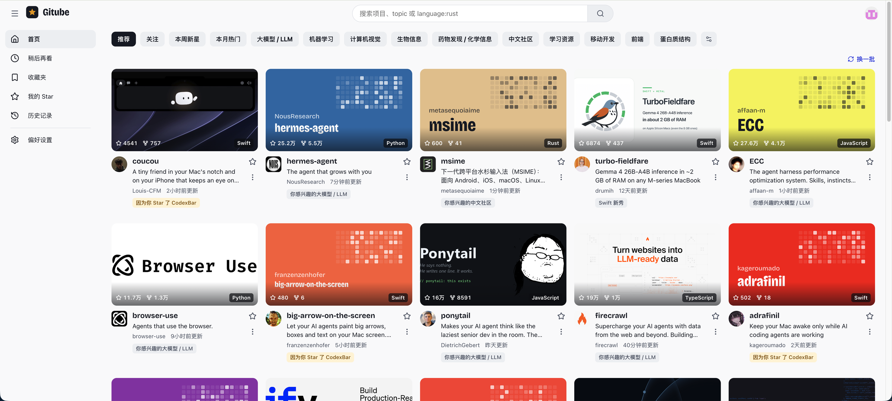

<p align="center">
  
</p>

<p align="center">
  <a href="https://andy7016.github.io/Gitube/"><b>Open the web app</b></a>
  &nbsp;|&nbsp;
  <a href="https://github.com/Andy7016/Gitube/releases/latest"><b>Download for desktop</b></a>
  &nbsp;|&nbsp;
  <a href="README.md">中文</a>
</p>

<p align="center">
  <a href="https://github.com/Andy7016/Gitube/releases/latest"></a>
  <a href="LICENSE"></a>
  
</p>

**Gitube** lets you browse GitHub the way you scroll YouTube. Sign in with your GitHub account and get an endless feed of open-source projects picked for you. Star the ones you like in one click, or save them for later.

It is fully open source and has no server of its own: your token stays on your device, and every request goes straight to GitHub.

> The interface is currently in Chinese. An English UI is on the roadmap.

<p align="center">
  
</p>

## Features

- **A feed picked for you.** Recommendations come from what you've recently starred, your own repositories, the interests you choose, public stars from people you follow, and what you do in the app (star, save, open, qualified reading, "not interested"). Every card says why it's there: "because you starred X", "@someone starred this", "new this week".
- **Three recommendation modes.** Home and Settings share Normal, Something different and Random. Each mode keeps its own list and scroll position during the current app session, so switching back resumes where you left off.
- **Following weights.** Adjust each sampled person's recommendation influence in Settings from 0 to 3, with a default of 1. A weight of 0 excludes their influence without unfollowing them on GitHub.
- **Channels.** For you, Following (what people you follow just starred), New this week, Hot this month, plus one channel per interest (bioinformatics, LLMs, Rust…).
- **One-click actions.**
  - The star on each card stars the repo on your real GitHub account.
  - Hover a cover for *Watch later* and *Save*.
  - The ⋮ menu: save to a collection, copy the `git clone` command, "not interested", hide a topic or language.
  - On a project page, **press and hold Star** to star, save and follow the author in one go. Shortcuts: `S` star, `B` save to…, `L` watch later.
- **Project page** laid out like a video page: details and README on the left, related projects on the right.
- **Learning from reading.** Only time when the project page is visible and focused counts. A small interest signal is recorded after strictly more than 3 minutes, or strictly more than 1 minute plus opening that page's original repository. Each account and repository can contribute at most once per 24 hours; background or unfocused time does not count.
- **Collections**, **Watch later**, **History**, **My stars**, and **Search** with full GitHub search syntax (`topic:bioinformatics stars:>500`).
- **Covers.** Projects with a custom social preview use it. Others get a generated cover: the background is the main language's color, and the brighter and denser the grid in the corner, the more active the project has been lately.
- Light and dark themes; works in mobile browsers too.

## Getting started: sign in

**Desktop app:** click *使用 GitHub 账号登录* (Sign in with GitHub). Gitube shows a short code. Click the button below it to copy the code and open GitHub, paste the code in your browser and click **Authorize**. Gitube signs you in automatically, with no token to create. You can revoke access any time under GitHub *Settings → Applications*.

**Web app** (or expand *用 Personal Access Token 登录* in the desktop app):

1. Use the link on the sign-in page to open GitHub's "new token" page. The scopes are already ticked: `public_repo`, `read:user`, `user:follow`.
2. Pick an expiration, scroll down and click **Generate token**.
3. Copy the token (it starts with `ghp_`) and paste it into Gitube.

The token is stored only on your device and is only sent to the GitHub API. Fine-grained tokens work too: under Account permissions, set **Starring** to Read and write, and **Followers** to Read and write (only needed for "follow the author").

## Installing the desktop app

Download from [Releases](https://github.com/Andy7016/Gitube/releases):

| System | File |
| --- | --- |
| Mac with Apple silicon (M1/M2/M3/M4…) | `Gitube_x.x.x_aarch64.dmg` |
| Mac with Intel | `Gitube_x.x.x_x64.dmg` |
| Windows | `Gitube_x.x.x_x64-setup.exe` |
| Linux | `.AppImage` or `.deb` |

The app isn't signed with a paid Apple or Microsoft certificate, so the first launch is blocked once:

- **macOS:** if it says the developer can't be verified or the app is damaged, open *System Settings → Privacy & Security* and click *Open Anyway*, or run `xattr -cr /Applications/Gitube.app` in Terminal.
- **Windows:** if SmartScreen appears, click *More info → Run anyway*.

## Development

Want to contribute? Start with [CONTRIBUTING.md](CONTRIBUTING.md) (in Chinese).

Requires Node.js 20.19 or later (22 LTS recommended).

```bash
npm install
npm run dev          # web app at http://localhost:5173
```

The desktop app also needs [Rust](https://www.rust-lang.org/tools/install) (and on macOS, `xcode-select --install`):

```bash
npm run desktop:dev     # open the desktop window with hot reload
npm run desktop:build   # build installers into src-tauri/target/release/bundle/
```

## Releasing

Two workflows live in `.github/workflows/`:

- **Web** (`pages.yml`): every push to `main` builds and deploys to GitHub Pages. Before the first run, set *Settings → Pages → Source* to **GitHub Actions**.
- **Desktop** (`release.yml`): go to *Actions → 发布桌面软件 (Publish desktop) → Run workflow*. About 15 minutes later, installers for every platform appear under Releases. Bump `"version"` in `src-tauri/tauri.conf.json` before each new release.

## How recommendations work

Everything runs on your device, with the same `src/lib/recommend.ts` in the web and desktop apps. Normal recommendations follow these steps:

1. **Profile.** Weights for each topic and language, from your latest 100 stars (newer stars count more), your own repositories, your chosen interests (strongest signal), sampled public stars from people you follow, and in-app actions (star +2.5, save +2, watch later +1, open +0.6, qualified reading +0.3, not interested −3, with a 30-day half-life).
2. **Candidates.** A few topics are sampled by weight (each searched three ways: all-time top, recently active, new this year), plus "similar to something you starred", "new in your languages", "new this week" and "something different". Each round combines its searches into **one** GraphQL request.
3. **Filtering.** Drops anything already starred, owned by you, marked not interested, in a hidden topic or language, or shown in the last 3 days.
4. **Ranking.** 50% interest match + 25% popularity + 15% recent activity + a little randomness, then spread out so the same owner, language or source doesn't cluster.
5. Projects starred by people you follow are mixed in, prioritized by the person's weight and how recently they starred the project.

The "how Gitube sees you" section in Settings shows your current profile. The following influence controls list only people whose star samples were actually retrieved: up to 50 people, with their 6 most recent public stars each. This does not cover all their interests. Contributions are normalized per person and decay with a 30-day half-life, so more samples do not automatically mean more influence. A weight of 0 leaves the original Following channel unchanged.

"Something different" classifies actual candidates using the topics of your explicitly chosen, unblocked interests. It targets roughly 50% inside those interests and 50% outside; either side fills a shortage on the other. Without usable chosen interests, this mode is unavailable and switches back to Normal. "Random" searches public projects using random creation windows, star ranges and sort variants, then shuffles the actual candidate pool. It is not uniform sampling across all of GitHub. Both exploration modes use at most 3 rounds of 8 search conditions per batch, skip profile and following-weight ranking, and do not insert targeted social picks. Existing filters still apply; stars, saves, opens and qualified reading continue to accumulate for Normal recommendations.

Each mode has separate pagination progress while sharing recent-exposure and feedback filters. "重置推荐记录" (Reset recommendation history) in Settings restores Normal and default following weights, and clears recommendation feedback, hidden topics and languages, exposures, reading signals and all mode cursors. Collections, watch later and history are kept.

## Where your data lives

- **Stars and follows** go straight to your GitHub account.
- **Collections, watch later, history, feedback, following weights, reading signals, recommendation mode and pagination progress** have no public GitHub API, so they're kept in local storage per GitHub user. The web and desktop apps keep separate copies.
- **Your token** stays in local storage and is removed when you sign out.

## Project layout

```
src/
  api/github.ts        GitHub GraphQL / REST calls
  lib/recommend.ts     recommendation engine
  api/graph.ts         frontend provenance graph entry point
  lib/graph/           evidence extraction, relationship semantics, bounded public-data collection
  lib/channels.ts      home-page channels
  lib/interests.ts     interest tags ↔ GitHub topics
  lib/cover.ts         generated covers
  lib/actions.ts       save, watch later, not interested, star + save + follow
  lib/deviceLogin.ts   "Sign in with GitHub" in the desktop app (GitHub device flow)
  store/               state (zustand)
  components/          cards, covers, star button, menus, dialogs…
  pages/               sign-in, onboarding, home, project, library, search, settings
src-tauri/             desktop app (Tauri); the Rust side sends the GitHub sign-in requests
.github/workflows/     web and desktop publishing
```

## Technology provenance graph

Project details analyze one level of public sources. The graph page also accepts a GitHub repository URL or `owner/repo`. Select a node to inspect its source text, file/line link, and classification reason; expand it manually or use it as a new root. Panning, zooming, and centering only change the view.

The shared web/desktop frontend reads public README references, explicit GitHub dependency URLs, contributors, CODEOWNERS, and maintainer evidence directly from GitHub. Only explicit upstream/downstream statements produce provider-to-consumer arrows. References, acknowledgments, shared people, and similar topics do not establish technical ancestry. Node area represents topic Jaccard similarity; language-only matches are labeled separately, and graph distance does not represent similarity.

Each analysis allows at most 48 requests, 3 concurrent requests, and 90 seconds, resolving up to 12 direct targets and sampling up to 2 people with 30 public owned repositories each. Limits and failures are shown with partial results. Manual expansion is capped at 120 nodes and depth 5 per workspace. Up to 8 root workspaces retain results, selection, and camera during the current session; returning restores them without another analysis. Logout, account changes, or an application reload start fresh. A failed refresh keeps the previous result.

No custom server, external-site crawler, or package-name-to-repository guessing is involved. See [Issue #3](https://github.com/Andy7016/Gitube/issues/3) and [ADR 0004](docs/adr/0004-frontend-provenance-graph.md) for the proposal and implementation decisions.

## License

[MIT](LICENSE)
